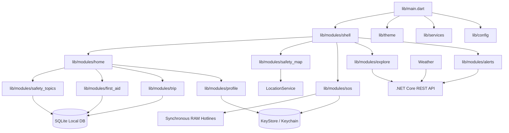

# Feature Analysis & Module Breakdown: Safe Travel Sri Lanka

**Version:** 1.0.0  
**Status:** COMPLETE (Planning & Architecture)  
**Reference Document:** Prototype [https://safetravelbyredcross.netlify.app/](https://safetravelbyredcross.netlify.app/)  

---

## 1. Feature Inventory & Prioritization Matrix

* **P0 (Life-Critical & Shell):** Essential offline content, emergency dialing, routing shell, theme system.
* **P1 (Core Value):** Weather, hazard alerts, explore directory, interactive safety map, trip go-bag.
* **P2 (Enhancements):** Remote I'm Safe broadcast, background push alerts, cloud account sync.

| Module | Feature Description | Priority | Execution Mode | Phase | Complexity |
|---|---|:---:|:---:|:---:|:---:|
| `shell` | 5-Tab Persistent Navigation (`IndexedStack`) + Red SOS Hub | P0 | Offline | Phase 1 | M |
| `theme` | Red Cross Brand Palette, Spacing Tokens, Dark/Light Mode | P0 | Offline | Phase 1 | S |
| `database` | SQLite Init, Migrations, Bundled JSON Seed Loader | P0 | Offline | Phase 1 | M |
| `sos` | Pre-Warmed Emergency Hotlines (0ms) & Tel Sanitizer Guard | P0 | Offline (Tel) | Phase 2 | S |
| `first_aid` | Step-by-Step IFRC First Aid Manuals & Search | P0 | Offline | Phase 2 | M |
| `safety_topics` | 8 Topic Categories (Floods, Landslides, Coastal, Wildlife) | P0 | Offline | Phase 2 | M |
| `onboarding` | Red Cross Welcome, Carousel, Location & Notification Setup | P0 | Offline | Phase 2 | M |
| `home` | Dashboard: Greeting, Weather, Active Alert Banner, Quick Access | P1 | Hybrid (SWR) | Phase 3 | L |
| `alerts` | Chronological Real-Time Alerts Feed & Severity Triaging | P1 | Hybrid (SWR) | Phase 3 | M |
| `explore` | Traveler Directory (Hotels, Clinics) + Weather-Adaptive Mode | P1 | Hybrid (SWR) | Phase 3 | L |
| `safety_map` | Interactive Map with Hazard Zones & Red Cross Stations | P1 | Online + Fallback | Phase 3 | XL |
| `trip` | Trip Itinerary Planner & Emergency Go-Bag Checklist | P1 | Offline-First | Phase 4 | M |
| `profile` | ICE Contacts, Medical Info, Language (EN/SI/TA) Switcher | P1 | Offline-First | Phase 4 | M |
| `notifications` | Firebase Cloud Messaging (FCM) Emergency Siren Alerts | P2 | Online | Phase 5 | M |
| `sync` | Incremental Content Delta Sync from .NET API | P2 | Online | Phase 5 | M |

---

## 2. Module-by-Module Technical Breakdown

### 2.1 Shell & Navigation (`lib/modules/shell/`)
* **Purpose:** Root application container hosting the persistent 5-branch navigation.
* **Key Components:**
  * `AppShell`: Hosts `Scaffold` and `StatefulNavigationShell` from `go_router`.
  * `SosCenterButton`: Prominent elevated red circular button in center of the bottom navigation bar.
  * `ConnectivityBanner`: Non-intrusive top banner indicating `"Limited — offline mode"`.
* **State Preservation:** Uses `IndexedStack` to ensure scrolling position and forms in tabs are never dropped when switching between Home, Map, SOS, Explore, and Alerts.

### 2.2 Onboarding (`lib/modules/onboarding/`)
* **Pages:** `WelcomePage`, `OnboardingCarouselPage`, `PermissionSetupPage`, `AllSetPage`.
* **Flow:** First launch presentation introducing Red Cross humanitarian affiliation, highlighting offline safety capabilities, requesting fine/coarse location and notification permissions, and completing SQLite asset bundle unpack.
* **Storage:** Flag `onboarding_complete: true` written to `shared_preferences`.

### 2.3 Home Dashboard (`lib/modules/home/`)
* **Page:** `HomePage`
* **Widgets:**
  1. `GreetingHeader`: Displays user location name, date, and connection badge.
  2. `WeatherCard`: Live temperature, feels-like, wind speed, weather icon (SWR cache).
  3. `AlertBanner`: Dynamic high-contrast banner displayed **only** when an active hazard (e.g., Landslide Watch) exists in user's province.
  4. `QuickAccessGrid`: 2x2 grid directing to Safety Map, First Aid, Explore, and "I'm Safe".
  5. `GoBagSummaryCard`: Progress indicator of packed survival supplies.
  6. `ExploreNearYou`: Horizontal carousel of nearby verified facilities.
  7. `SafetyTopicsGrid`: 8 category cards with icons.
* **Context-Aware Behavior:** If an active Red Alert exists, the theme shifts background highlights to warm alert tones and places the `AlertBanner` at the top of the viewport.

### 2.4 SOS & Emergency Services (`lib/modules/sos/`)
* **Page / Sheet:** `SosBottomSheet`, `DialConfirmationSheet`.
* **Performance Mandate:** 0ms latency. The emergency hotline list (Police 119, Suwa Seriya 1990, Disaster DMC 117, Tourist Police) is held in synchronous memory cache.
* **Safety Guard:** Validates all numbers against `^\+?[0-9]{3,12}$` via `PhoneNumberSanitizer` before handing off to `url_launcher`. Prevents USSD code hijacking.

### 2.5 Safety Topics & Guides (`lib/modules/safety_topics/`)
* **Pages:** `SafetyTopicsListPage`, `SafetyTopicDetailPage`.
* **Content:** 8 core offline categories.
  * Floods & Landslides (NBRO safety advice).
  * Coastal & Beach Safety (riptides, monsoon patterns).
  * Health & Tropical Diseases (dengue, hydration).
  * First Aid Procedures (IFRC quick reference).
  * Road & Transit Safety (train doors, tuk-tuk guidelines).
  * Wildlife Encounters (elephants, snakebite prevention).
  * Personal Safety (scams, emergency registration).
  * Disaster Readiness (go-bag assembly).
* **Storage:** Querying indexed SQLite `safety_topics` and `safety_topic_details` with instant localized text resolution.

### 2.6 First Aid (`lib/modules/first_aid/`)
* **Pages:** `FirstAidIndexPage`, `FirstAidGuidePage`.
* **Features:** Step-by-step swipeable procedure cards, severity badges (`critical`, `moderate`, `minor`), high-contrast emergency warning blocks, offline search bar.

### 2.7 Safety Map (`lib/modules/safety_map/`)
* **Pages:** `SafetyMapPage`, `PlaceDetailSheet`.
* **Features:** Google Maps integration with custom marker icons (Red Cross stations, safe shelters, police posts, hospital trauma centers). Overlay circles / polygons representing active hazard warnings.
* **Offline Fallback:** If internet is disconnected, renders a clean vector overview map of Sri Lanka's 25 districts with emergency helpline anchors.

### 2.8 Explore Directory (`lib/modules/explore/`)
* **Pages:** `ExplorePage`, `ListingDetailPage`.
* **Features:** Category pills (Accommodation, Food, Medical, Transport, Diplomatic). Distance calculations from user location.
* **Weather-Adaptive Mode:** During severe storm warnings, the tab switches automatically to prioritizing indoor attractions, verified safe shelters, and 24/7 pharmacies.

### 2.9 Alerts Feed (`lib/modules/alerts/`)
* **Pages:** `AlertsFeedPage`, `AlertDetailPage`.
* **Features:** Filter tabs (All, Critical, Weather, Security). Pull-to-refresh SWR syncing. Detailed advisory text, affected zones, and direct advice from Sri Lanka Red Cross Society.

### 2.10 User Profile, Emergency Contacts & Trip (`lib/modules/profile/`, `lib/modules/trip/`)
* **Profile:** ICE Emergency Contacts (stored in `flutter_secure_storage`), Medical notes (allergies, blood group in KeyStore), Language toggle (English, Sinhala, Tamil).
* **Trip:** Itinerary manager, Go-Bag emergency kit checklist with persistent check states.

---

## 3. Module Dependency Graph

