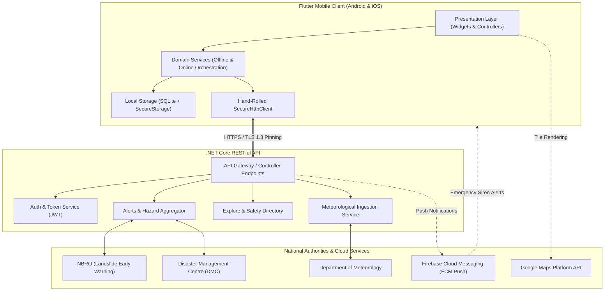
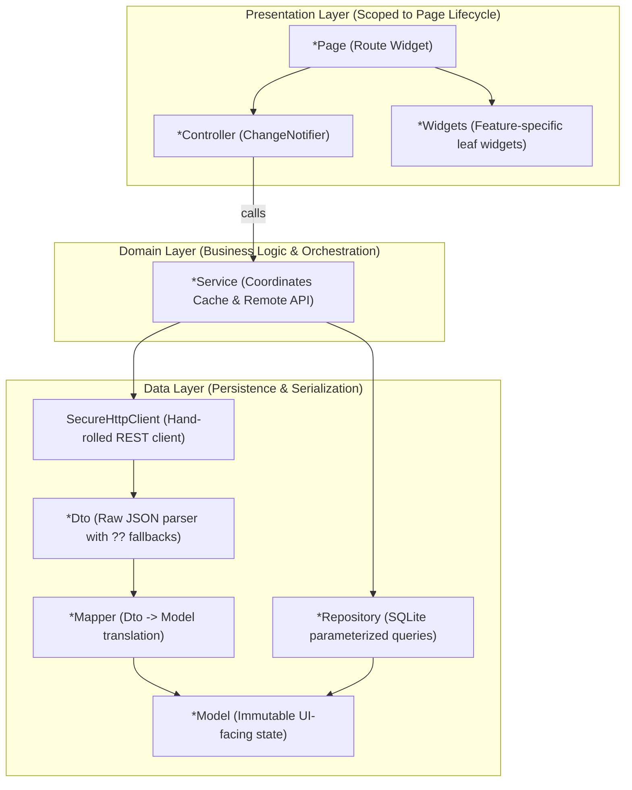
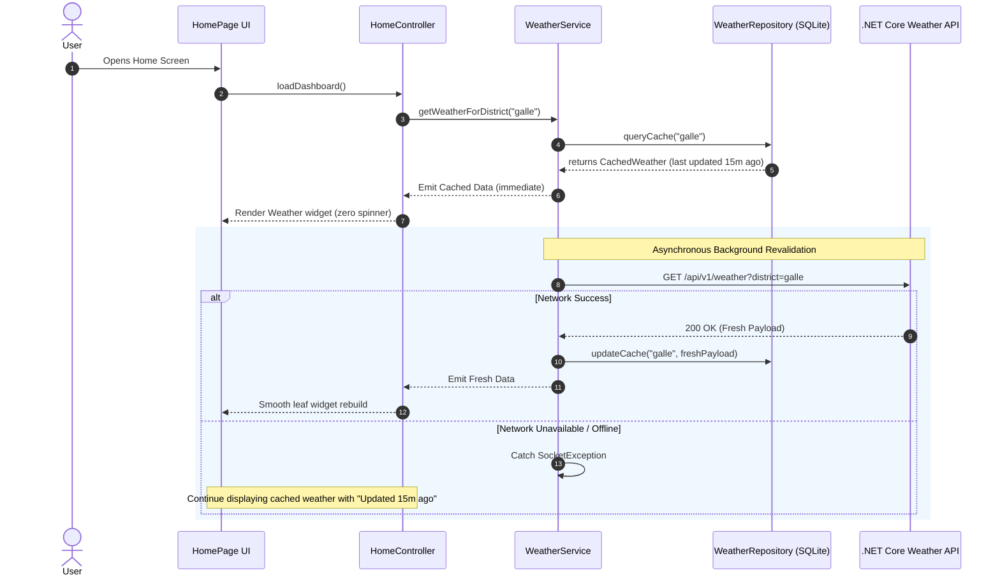
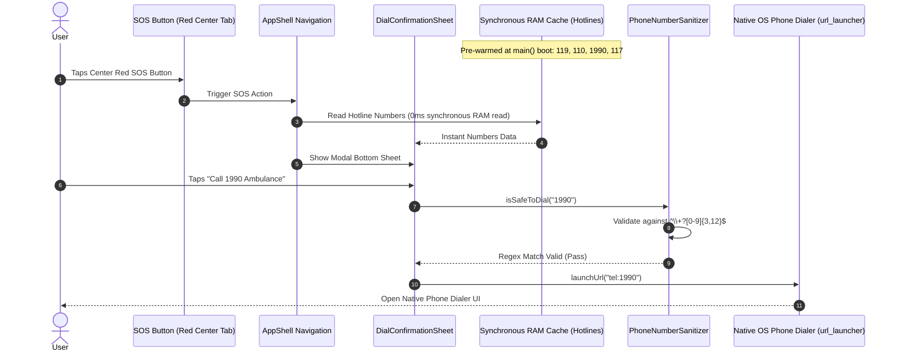

# System Design Document (SDD) — Safe Travel Sri Lanka

**Version:** 1.0.0-draft  
**Date:** 2026-11-19  
**Status:** DRAFT (Ready for Implementation; .NET Core API Integration Abstracted)  
**Affiliation:** Sri Lanka Red Cross Society  
**Author:** Software Architecture Team  

---

## 1. Executive Summary & Purpose

**Safe Travel Sri Lanka** (`safe_travel_sri_lanka`) is a mobile travel-safety, disaster preparedness, and emergency response platform built in Flutter/Dart. It serves international tourists, humanitarian staff, and domestic travelers navigating Sri Lanka.

### Core Architectural Mandates
1. **Offline-First Resilience:** Disaster scenarios frequently knock out cellular towers and internet backbones. Critical life-safety guides, first-aid instructions, emergency hotlines, and go-bag checklists are physically bundled inside the app client and guaranteed to operate with zero connectivity.
2. **Stress-Ready UX:** High-contrast visual tokens, minimum 48dp touch targets, zero mental friction, and a 0ms pre-warmed emergency SOS dialer.
3. **Tri-Lingual Parity (Decision D10):** Native support for English (`en`), Sinhala (`si`), and Tamil (`ta`).
4. **Pragmatic Simplicity (Anti-Overengineering / KISS):** Strict 3-layer architecture (`datalayer/` → `domainlayer/` → `presentationlayer/`), plain `ChangeNotifier` route controllers, no speculative abstractions.

---

## 2. System Context & Topology

---

## 3. Layered Module Architecture

Each feature module under `lib/modules/<feature>/` strictly implements a 3-layer boundary:

---

## 4. Entity-Relationship Diagram (ERD)

The complete local relational schema executed in SQLite (`safe_travel.db`). Encrypted via SQLCipher for user personal items.

```mermaid
erDiagram
    %% =========================================================
    %% BUNDLED OFFLINE STATIC CONTENT
    %% =========================================================
    safety_topics ||--o{ safety_topic_details : contains
    safety_topics {
        int id PK
        string category_key UK "floods_landslides, beach_safety, etc."
        string title_en
        string title_si
        string title_ta
        string description_en
        string description_si
        string description_ta
        string icon_asset_path
        int sort_order
        int is_active
        string created_at
        string updated_at
    }

    safety_topic_details {
        int id PK
        int topic_id FK
        string section_title_en
        string section_title_si
        string section_title_ta
        string content_en
        string content_si
        string content_ta
        string media_type "text, image, video_link"
        string media_url
        int sort_order
    }

    first_aid_guides ||--o{ first_aid_steps : prescribes
    first_aid_guides {
        int id PK
        string guide_code UK "FA_SNAKEBITE, etc."
        string title_en
        string title_si
        string title_ta
        string severity "critical, moderate, minor"
        string search_keywords
        int sort_order
        int is_active
    }

    first_aid_steps {
        int id PK
        int guide_id FK
        int step_number
        string instruction_en
        string instruction_si
        string instruction_ta
        string image_asset_path
        string warning_text_en
        string warning_text_si
        string warning_text_ta
    }

    emergency_numbers {
        int id PK
        string service_code UK "POLICE_119, AMBULANCE_1990"
        string service_name_en
        string service_name_si
        string service_name_ta
        string phone_number
        string category "police, medical, fire, disaster, redcross"
        int is_primary
        string icon_asset_path
        int sort_order
    }

    go_bag_items ||--o{ user_go_bag_checks : checks
    go_bag_items {
        int id PK
        string item_code UK
        string item_name_en
        string item_name_si
        string item_name_ta
        string category "documents, medical, clothing, food_water, tools"
        string description_en
        int is_essential
        int sort_order
    }

    %% =========================================================
    %% CACHED ONLINE CONTENT (SWR)
    %% =========================================================
    hazard_alerts {
        string id PK "Remote Server GUID"
        string title_en
        string title_si
        string title_ta
        string description_en
        string severity "critical, high, moderate, low, info"
        string hazard_type "flood, landslide, storm, tsunami"
        string affected_area_name
        real latitude
        real longitude
        real radius_km
        string source "NBRO, DMC, SLRC"
        string issued_at
        string expires_at
        int is_active
        string fetched_at
        string raw_json
    }

    weather_cache {
        string district_key PK "colombo, galle, kandy"
        string district_name_en
        real temperature_celsius
        real feels_like_celsius
        int humidity_percent
        real wind_speed_kmh
        string condition_code
        string condition_text_en
        string icon_url
        string fetched_at
        string expires_at
    }

    explore_listings {
        string id PK "Remote Server GUID"
        string name
        string category "accommodation, food, medical, transport, embassy"
        string description_en
        string address
        real latitude
        real longitude
        string phone
        real rating
        int is_indoor
        int is_emergency_facility
        string fetched_at
    }

    map_points {
        string id PK
        string type "hazard_zone, safe_zone, redcross_point, shelter"
        string label_en
        real latitude
        real longitude
        real radius_km
        string severity
        string metadata_json
        int is_active
        string fetched_at
    }

    %% =========================================================
    %% USER PRIVATE DATA (SQLCipher Encrypted)
    %% =========================================================
    user_trips ||--o{ user_go_bag_checks : tracks
    user_trips {
        string id PK "Client UUIDv4"
        string trip_name
        string destination
        string start_date
        string end_date
        string notes
        string created_at
    }

    user_go_bag_checks {
        int id PK
        string trip_id FK "Nullable: master or trip-specific"
        int item_id FK
        int is_checked
        string checked_at
    }

    content_sync_metadata {
        string entity_type PK
        string last_synced_at
        string etag
        int record_count
        string sync_status
    }
```

---

## 5. Sequence Flows & Operational Protocols

### 5.1 Stale-While-Revalidate (SWR) Pattern for Weather & Alerts
Prevents UI spin-blocks by providing instant cached data to the screen while quietly refreshing from the .NET Core backend.

### 5.2 Zero-Latency Emergency SOS Flow
Guarantees emergency hotlines are accessible within 0ms without waiting for disk I/O, database initialization, or network availability.

---

## 6. Abstracted API Integration Layer

Because the external .NET Core API documentation is pending delivery, all network interactions are cleanly insulated behind domain interfaces:

| Expected Endpoint | HTTP Method | Client Service Method | Local Cache Repository |
|---|:---:|---|---|
| `/api/v1/alerts/active` | `GET` | `AlertsService.getActiveAlerts()` | `HazardAlertsRepository` |
| `/api/v1/weather` | `GET` | `WeatherService.getWeather(district)` | `WeatherCacheRepository` |
| `/api/v1/explore` | `GET` | `ExploreService.getListings(coords, radius)` | `ExploreRepository` |
| `/api/v1/map/points` | `GET` | `SafetyMapService.getMapOverlays()` | `MapPointsRepository` |
| `/api/v1/content/sync` | `GET` | `OfflineContentService.syncDelta()` | `ContentSyncRepository` |
| `/api/v1/safety/broadcast` | `POST` | `SosService.broadcastImSafe(telemetry)` | Transmitted live or fallback to SMS |
| `/api/v1/auth/login` | `POST` | `AuthService.login(credentials)` | `SecureStorageService` (Tokens) |
| `/api/v1/auth/refresh` | `POST` | `AuthService.refreshToken()` | `SecureStorageService` (Tokens) |

---

## 7. Performance & Quality Benchmarks

| Metric | Target Budget | Enforcement Mechanism |
|---|---|---|
| **Cold Start to First Frame** | `< 1.2s` | Zero async blocking in `main()`; DB and background sync warm up after first paint |
| **SOS Action to Dialer** | `0ms` | Pre-warmed in-memory RAM cache at startup |
| **Tab Switch Latency** | `< 16ms (60fps)` | `go_router` StatefulShellRoute + `IndexedStack` preserving sub-trees |
| **Offline Content Lookup** | `< 100ms` | Indexed SQLite B-Tree queries with limit/offset |
| **Heavy JSON Processing** | Background | `Isolate.run()` for all payloads > 50KB |
